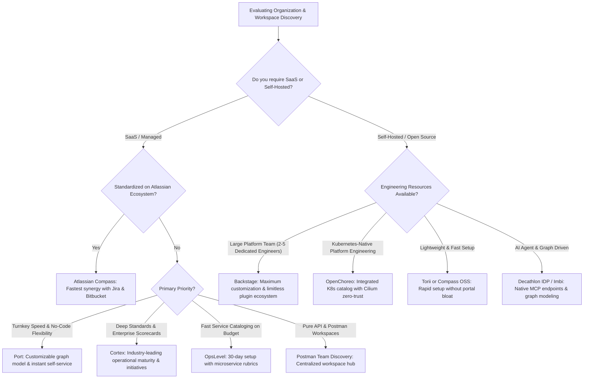

# 🌐 Awesome Organization, Team &amp; Workspace Discovery 🚀

> 🌟 **A curated, search-engine-optimized list of top Organization, Team, and Workspace Discovery platforms** — encompassing enterprise SaaS/hosted commercial Internal Developer Portals (IDPs) and self-hosted open-source software solutions for cataloging microservices, mapping team ownership boundaries, and uncovering workspace context across modern engineering organizations. 🌟

---

## 📑 Table of Contents

- [🌐 Overview &amp; Market Vision](#-overview--market-vision)
- [📈 Sector Overview &amp; Market Dynamics](#-sector-overview--market-dynamics)
- [🟦 Commercial SaaS &amp; Hosted Platforms](#-commercial-saas--hosted-platforms)
  - [SaaS Solutions Comparison Matrix](#-saas-solutions-comparison-matrix)
  - [Detailed SaaS Platform Deep Dives](#-detailed-saas-platform-deep-dives)
- [🟩 Open-Source Software Solutions](#-open-source-software-solutions)
  - [Open-Source Solutions Comparison Table](#-open-source-solutions-comparison-table)
  - [Detailed Open-Source Profiles](#-detailed-open-source-profiles)
- [📊 Feature Comparison at a Glance](#-feature-comparison-at-a-glance)
- [🎯 Selection Guide: How to Choose](#-selection-guide-how-to-choose)
- [🤝 Contributing](#-contributing)
- [💖 Support &amp; Sponsorship](#-support--sponsorship)
- [⭐ Star History](#-star-history)
- [📄 License](#-license)

---

## 🌐 Overview &amp; Market Vision

Modern cloud-native software architectures—dominated by microservices, distributed cloud infrastructure, Kubernetes clusters, and decoupled agile teams—inevitably trigger developer cognitive overload and context fragmentation. 

**Organization, Team &amp; Workspace Discovery platforms** (frequently packaged as **Internal Developer Portals (IDPs)** and **Centralized Service Catalogs**) solve this crisis by establishing a single source of truth for:
- 🧭 **Service &amp; API Discoverability:** Discover who owns what service, API contracts, deployment health, dependencies, and documentation.
- 👥 **Team &amp; Domain Ownership:** Eradicate orphaned microservices and establish clear escalation paths, on-call assignments, and team topologies.
- 📐 **Engineering Standards &amp; Scorecards:** Enforce production readiness, SLO compliance, security vulnerability posture, and AI governance.
- 🛠️ **Developer Self-Service:** Scaffold compliant repositories, provision infrastructure, and accelerate developer velocity without ticket bottlenecks.

---

## 📈 Sector Overview &amp; Market Dynamics

> 💡 **Market Size &amp; Industry Trajectory:** The global Internal Developer Platform (IDP) and developer portal market is estimated at **$6.8B to $7.3B in 2025**, with projections accelerating past **$8.8B in 2026** and heading toward **$15B+ by 2030** at a compound annual growth rate (CAGR) of **15% to 21%**.
>
> ⚖️ **Market Structure &amp; Dynamics:** The sector is **moderately fragmented and rapidly consolidating**. While Spotify's open-source **Backstage** serves as the dominant de facto framework anchoring developer mindshare, high total cost of ownership (TCO) and multi-quarter implementation cycles have fueled a competitive surge of commercial SaaS challengers (e.g., Port, Cortex, OpsLevel) alongside incumbent collaboration ecosystems (e.g., Atlassian Compass, Postman). Rather than a single winner-take-all monopoly, the landscape is crystallizing around an enterprise bifurcation: hyper-extensible customizable frameworks for tech giants versus fast-time-to-value, no-code/turnkey portals for mid-market and enterprise platform teams.

---

## 🟦 Commercial SaaS &amp; Hosted Platforms

Commercial, managed Internal Developer Portals and discovery solutions engineered for enterprise reliability, immediate time-to-value, turnkey integrations, and automated operational scorecards.

### 📋 SaaS Solutions Comparison Matrix

The table below organizes leading SaaS discovery platforms, **sorted in descending order by company scale (Valuation / Revenue)**:

| Platform 🏢 | Valuation / Scale 💰 | Pricing (Starting Tier) 🏷️ | Free Tier / Trial Limits 🎁 | Key Capabilities ⚙️ | Best For 🎯 |
|:---|:---|:---|:---|:---|:---|
| **[Atlassian Compass](https://www.atlassian.com/software/compass)** | **$37.0B Market Cap** *(FY26 Rev: ~$6.57B)* | **$7.67 / user / month** *(Standard tier; Premium at $23.96/user/mo)* | **Free forever plan** up to **3 full users** &amp; unlimited basic users; or **14-day free trial** of Standard/Premium | Native Jira/Bitbucket cataloging, component health, scorecards, distributed architecture mapping | Atlassian-native engineering organizations wanting deep Jira/Confluence integration |
| **[Postman Team Discovery](https://www.postman.com)** | **$5.6B Valuation** *(Est. ARR: ~$310M+)* | **$19 / user / month** *(Team plan, billed annually; Enterprise at $49/user/mo)* | **Free forever plan** strictly limited to **1 single user** *(no team sharing); shared workspaces require paid plan or **14-day free trial** of Team/Enterprise* | Workspace discovery, public/private API publisher profiles, centralized API catalog, domain capture | Organizations needing centralized workspace and API discovery across teams |
| **[Port](https://www.getport.io)** | **$800M Valuation** *(Series C, $100M raised)* | **$30 / user / month** *(Basic tier, billed annually; Standard at $48/user/mo)* | **Free forever plan** up to **5 users** (evaluations up to 15 seats), **10,000 entities**, and **500 runs/month**; or **14-day free trial** | No-code software catalog, self-service actions, customizable scorecards, AI portal assistant | Mid-market to enterprise teams seeking modern IDP rollouts in days without frontend coding |
| **[Cortex](https://www.cortex.io)** | **$470M Valuation** *(Series C, $60M raised)* | **~$65 / user / month** *(AWS Marketplace baseline: ~$39,000/yr for 50 users)* | **14-day enterprise evaluation / POC trial** *(gated via sales/demo provisioning; no perpetual free tier)* | Comprehensive operational maturity scorecards, developer initiatives, automated SLO tracking, CTO dashboards | Mature enterprises prioritizing operational excellence, rigorous standards, and microservice governance |
| **[OpsLevel](https://www.opslevel.com)** | **$75M Valuation** *(~$22.2M raised)* | **$39 / developer / month** *(Baseline packaging billed annually)* | **14-day free trial / POC engagement** *(gated via sales consultation; no perpetual free tier)* | Fast-deployment microservices catalog, production readiness checks, GitOps-driven checks | Engineering teams prioritizing rapid 30-day deployment and budget-conscious microservice cataloging |

---

### 🔍 Detailed SaaS Platform Deep Dives

#### 🏢 Atlassian Compass
- **Overview:** Compass serves as a developer experience platform and software architecture catalog deeply woven into Jira, Bitbucket, Opsgenie, and the broader Atlassian Cloud suite.
- **Key Strengths:** Automatic component discovery from Git repositories, built-in DevOps health scorecards, audit tracking, and dependency visualization.
- **Starting Pricing:** **$7.67 per user/month** (Standard) or **$23.96 per user/month** (Premium).
- **Free Tier Limits:** **Free forever plan** supporting up to 3 full access users and unlimited basic viewers.

#### 🏢 Postman Team Discovery
- **Overview:** Postman’s workspace discovery module unifies distributed teams, API collections, environments, and mock servers across enterprise domains.
- **Key Strengths:** Team directory searching, domain auto-join policies, public/private API publisher portals, and centralized API governance.
- **Starting Pricing:** **$19 per user/month** (Team plan, billed annually).
- **Free Tier Limits:** **Free forever plan** for 1 solo user (multi-user team workspaces require a paid tier or 14-day trial).

#### 🏢 Port (getport.io)
- **Overview:** An AI-powered, modern internal developer portal offering extreme flexibility through an entirely customizable data model and no-code UI builder.
- **Key Strengths:** Ingests data from any source (cloud providers, CI/CD, K8s, PagerDuty), native self-service execution, and granular role-based access control.
- **Starting Pricing:** **$30 per seat/month** (Basic plan, billed annually).
- **Free Tier Limits:** **Free forever plan** capped at 5 users (promotional evaluations up to 15), 10,000 catalog entities, and 500 action executions.

#### 🏢 Cortex (cortex.io)
- **Overview:** An enterprise-grade developer portal renowned for its powerful **Scorecards** and **Initiatives** frameworks that drive continuous operational maturity.
- **Key Strengths:** Deep integrations across AWS, Azure, GCP, Datadog, SonarQube, and Kubernetes; executive CTO reporting dashboards.
- **Starting Pricing:** **~$65 per user/month** (entry packages typically begin at $39,000/year for 50 seats on cloud marketplaces).
- **Free Tier Limits:** **14-day custom POC / free trial** provided through sales consultation.

#### 🏢 OpsLevel
- **Overview:** A purpose-built microservice catalog and developer portal engineered for rapid deployment (typically 30–45 days) and straightforward service mapping.
- **Key Strengths:** Lightweight YAML configuration, automatic service dependency detection, rubrics for production standards, and developer self-service workflows.
- **Starting Pricing:** **$39 per developer/month** (billed annually).
- **Free Tier Limits:** **14-day guided proof-of-concept / free trial** for evaluation teams.

---

## 🟩 Open-Source Software Solutions

Self-hosted, vendor-neutral, and community-driven platforms providing complete data sovereignty, infrastructure flexibility, and extensible plugin ecosystems.

### 📋 Open-Source Solutions Comparison Table

The table below highlights top open-source projects, **sorted in descending order by GitHub Stars**:

| Project 📦 | Stars ⭐ | Primary Stack 💻 | License 📜 | Architecture Type 🏗️ | Stargazers 🌟 |
|:---|:---|:---|:---|:---|:---|
| **[Backstage](https://github.com/backstage/backstage)** |  | TypeScript, React, Node.js | Apache-2.0 | Full Internal Developer Portal &amp; Plugin Framework | [View Stargazers](https://github.com/backstage/backstage/stargazers) |
| **[OpenChoreo](https://github.com/openchoreo/openchoreo)** |  | Go, Kubernetes, Cilium | Apache-2.0 | Cloud-Native Internal Developer Platform &amp; Catalog | [View Stargazers](https://github.com/openchoreo/openchoreo/stargazers) |
| **[Torii](https://github.com/Qovery/Torii)** |  | Rust, TypeScript, React | Apache-2.0 | Lightweight, Extensible Internal Developer Portal | [View Stargazers](https://github.com/Qovery/Torii/stargazers) |
| **[Compass OSS](https://github.com/adinhodovic/compass)** |  | Go, Svelte, TailwindCSS | MIT | Lightweight Service, Dashboard &amp; Workspace Landing Page | [View Stargazers](https://github.com/adinhodovic/compass/stargazers) |
| **[UIGraph](https://github.com/uigraph-oss/uigraph)** |  | TypeScript, Next.js, React Flow | MIT | Software Architecture &amp; Service Map Visualizer | [View Stargazers](https://github.com/uigraph-oss/uigraph/stargazers) |
| **[OpenCRM](https://github.com/clawnify/opencrm)** |  | TypeScript, SQLite, Fastify | MIT | Lightweight Entity &amp; Organizational Relationship Catalog | [View Stargazers](https://github.com/clawnify/opencrm/stargazers) |
| **[Decathlon IDP](https://github.com/Decathlon/internal-developer-platform)** |  | Go, Temporal, GraphQL | Apache-2.0 | AI-Native IDP Backend with Dynamic Graph Modeling | [View Stargazers](https://github.com/Decathlon/internal-developer-platform/stargazers) |
| **[Imbi](https://github.com/aweber/imbi)** |  | Python, FastAPI, React, PostgreSQL | BSD-3-Clause | Graph-Based Service Inventory &amp; AI MCP Catalog | [View Stargazers](https://github.com/aweber/imbi/stargazers) |

---

### 🔍 Detailed Open-Source Profiles

#### 📦 [Backstage](https://github.com/backstage/backstage)
- **GitHub Stars:** 
- **Ecosystem Role:** Created by Spotify and incubated under the CNCF, Backstage is the industry's benchmark developer portal framework.
- **Core Components:**
  - 📖 **Software Catalog:** Centrally tracks services, APIs, libraries, and organizational teams via `catalog-info.yaml` manifests.
  - ⚡ **Software Templates (Scaffolder):** Empowers engineers to bootstrap new services adhering to corporate golden paths.
  - 📚 **TechDocs:** Markdown-driven documentation living adjacent to source code, compiled via MkDocs.
- **Operational Reality:** Highly extensible through hundreds of community plugins, but demands dedicated engineering ownership (2–5 platform engineers) to maintain and evolve.

#### 📦 [OpenChoreo](https://github.com/openchoreo/openchoreo)
- **GitHub Stars:** 
- **Ecosystem Role:** A complete, Kubernetes-native developer platform that integrates automated service discovery, GitOps pipelines, and zero-trust networking via Cilium.
- **Key Features:** Services automatically register endpoint contracts and access policies upon deployment, mapping real-time architectural components to Kubernetes resources.

#### 📦 [Torii](https://github.com/Qovery/Torii)
- **GitHub Stars:** 
- **Ecosystem Role:** Spearheaded by Qovery, Torii delivers an open-source, fast, and lightweight Internal Developer Portal built with modern Rust and React.
- **Key Features:** Tailored for platform teams requiring instant setup, low memory footprint, and modular extensions without Backstage's architectural complexity.

#### 📦 [Compass OSS (by Adin Hodovic)](https://github.com/adinhodovic/compass)
- **GitHub Stars:** 
- **Ecosystem Role:** An elegant, lightweight landing page and service catalog designed for single-pane discovery across container environments.
- **Key Features:** Automatically detects running services, dashboards, and internal documentation from Docker, Kubernetes, Tailscale, and NetBird network topologies.

#### 📦 [UIGraph](https://github.com/uigraph-oss/uigraph)
- **GitHub Stars:** 
- **Ecosystem Role:** An open-source architecture viewer and dynamic dependency visualizer.
- **Key Features:** Generates interactive service maps, API spec relationship graphs, and workspace visualizers directly from codebase structures.

#### 📦 [OpenCRM](https://github.com/clawnify/opencrm)
- **GitHub Stars:** 
- **Ecosystem Role:** Lightweight organizational directory and contact/company entity catalog with an intuitive REST API and relation columns.
- **Key Features:** Simplifies cross-department entity discovery and custom relation mapping outside purely technical service domains.

#### 📦 [Decathlon IDP Backend](https://github.com/Decathlon/internal-developer-platform)
- **GitHub Stars:** 
- **Ecosystem Role:** An extensible platform backend engineered specifically for the AI era by Decathlon's enterprise engineering group.
- **Key Features:** Dynamic graph-based entity modeling, real-time metadata ingestion, and native Model Context Protocol (MCP) server endpoints enabling AI agents to query catalog assets.

#### 📦 [Imbi](https://github.com/aweber/imbi)
- **GitHub Stars:** 
- **Ecosystem Role:** A focused service, environment, and project catalog developed by AWeber, powered by Python FastAPI, PostgreSQL (Apache AGE), and ClickHouse.
- **Key Features:** Native FastMCP integration exposing team and service catalogs directly to AI developer assistants, Docker Compose/Helm installation, and project lifecycle tagging.

---

## 📊 Feature Comparison at a Glance

| Solution 🛠️ | Deployment 🚀 | Service Catalog 🔍 | Team Ownership 👥 | Operational Scorecards 📊 | Developer Self-Service ⚡ | AI / MCP Ready 🤖 |
|:---|:---:|:---:|:---:|:---:|:---:|:---:|
| **Atlassian Compass** | Cloud SaaS | ✅ Rich | ✅ Jira/Confluence | ✅ Native | ✅ Templates | 🔄 Atlassian Rovo |
| **Postman Discovery** | Cloud SaaS | 🔄 API-Centric | ✅ Team Workspaces | ❌ | 🔄 Forking/Workspaces | ✅ Postman Postbot |
| **Port** | Cloud SaaS | ✅ Custom Graph | ✅ Deep RBAC | ✅ Real-time | ✅ Native Actions | ✅ Native Port AI |
| **Cortex** | Cloud SaaS | ✅ Enterprise | ✅ Multi-Hierarchy | ✅ Deep Initiatives | ✅ Workflows | ✅ AI Assistant |
| **OpsLevel** | Cloud SaaS | ✅ Microservices | ✅ GitOps Mapped | ✅ Rubrics | ✅ Self-Serve Hub | 🔄 Integration |
| **Backstage** | Self-Hosted | ✅ YAML-based | ✅ User/Group Entities | 🔌 Plugin-Based | ✅ Scaffolder | 🔌 Community Plugins |
| **OpenChoreo** | Self-Hosted / K8s | ✅ Automatic Discovery | ✅ Project-based | ❌ | ✅ Platform Pipelines | 🔄 Roadmap |
| **Torii** | Self-Hosted | ✅ Lightweight | ✅ Teams &amp; Roles | 🔄 Scorecards | ✅ Extensible | 🔄 Integration |
| **Compass OSS** | Self-Hosted | ✅ Auto-Network Sync | ✅ Service Links | ❌ | ❌ | ❌ |
| **UIGraph** | Self-Hosted / Local | ✅ Architecture Map | ✅ Service Nodes | ❌ | ❌ | ✅ AI Agent Skill |
| **Decathlon IDP** | Self-Hosted | ✅ Dynamic Graph | ✅ Domain Topologies | 🔄 Workflow Checks | ✅ Action Engine | ✅ Native FastMCP |
| **Imbi** | Self-Hosted | ✅ Graph Database | ✅ Team Permissions | ❌ | 🔄 CLI/API | ✅ Native FastMCP |

---

## 🎯 Selection Guide: How to Choose

---

## 🤝 Contributing

Contributions are warmly encouraged! Help us maintain the most comprehensive, accurate directory for organizational discovery tools:

1. 🍴 Fork the repository.
2. 🌿 Create your feature branch (`git checkout -b feature/awesome-addition`).
3. ✍️ Add the tool in alphabetical or sorted order with verified metadata, pricing, and license.
4. 💾 Commit your changes (`git commit -m 'Add exciting discovery tool'`).
5. 🚀 Push to the branch (`git push origin feature/awesome-addition`).
6. 📬 Submit a detailed Pull Request.

---

## 💖 Support &amp; Sponsorship

Thank you so much for using and exploring this curated collection! If you find this repository helpful for your team, platform engineering journey, or organization discovery efforts, please consider supporting the project:

- 🌟 **Star the repository** to boost discoverability and help other platform teams find it.
- 🍴 **Fork and contribute** to keep the dataset updated with cutting-edge tools and frameworks.
- 📢 **Share with colleagues, platform engineers, and developer communities**.
- ☕ **Buy a coffee / Sponsor the maintainer:** Support ongoing curation and maintenance via the [GitHub Sponsors Dashboard](https://github.com/sponsors/ishandutta2007).

---

## ⭐ Star History

---

## 📄 License

This compilation is dedicated to the public domain under the [Creative Commons Zero v1.0 Universal](LICENSE) (CC0 1.0). The referenced products and logos remain trademarks of their respective owners.

⭐ **If you find this directory valuable, please give it a star!** ⭐

